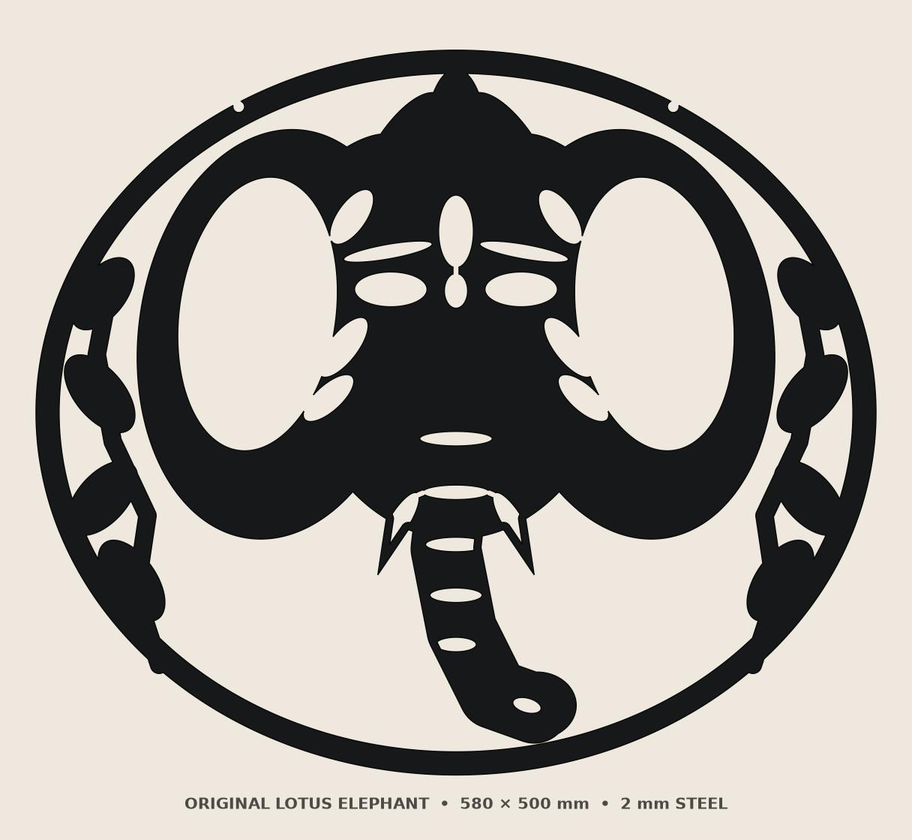

# Original Lotus Elephant CNC Panel

An original frontal elephant wall panel with broad ears, calm eyes, tusks, curled trunk, lotus-inspired crown, and symmetrical botanical scrollwork.



## Specification

- 580 × 500 mm
- 2 mm mild steel
- One connected component
- Two 8 mm mounting holes
- 4.993 mm minimum measured profile separation
- 19 closed DXF profiles on `CUT`
- Net metal area: 117,940.17 mm²
- Estimated mass: 1.8517 kg

## Reproduce

```bash
uv run --with matplotlib --with shapely --with ezdxf python scripts/generate.py
```

The generator creates the geometry directly. No external artwork is used.

## License

CC0 1.0 Universal. See `LICENSE`.
